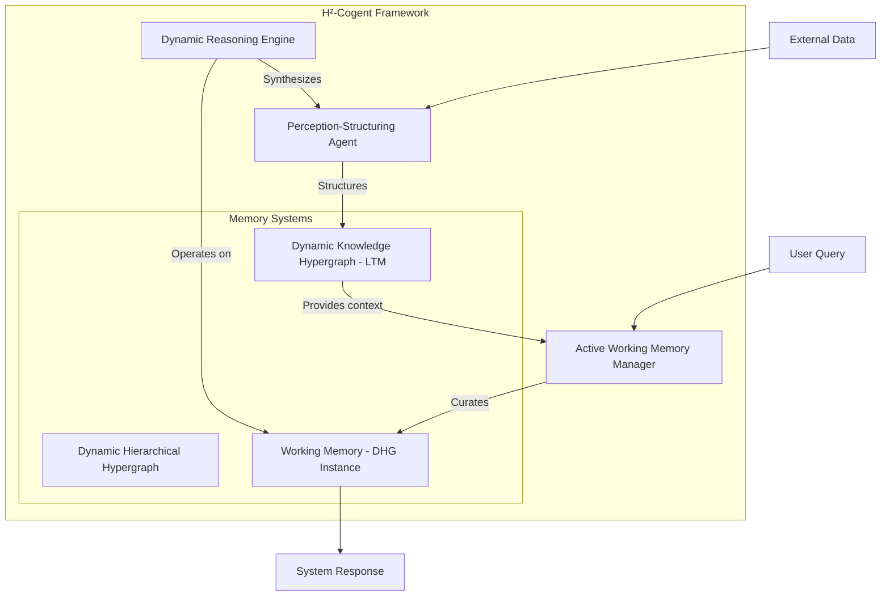
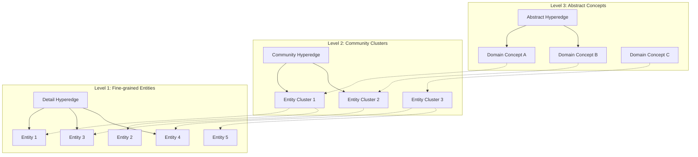
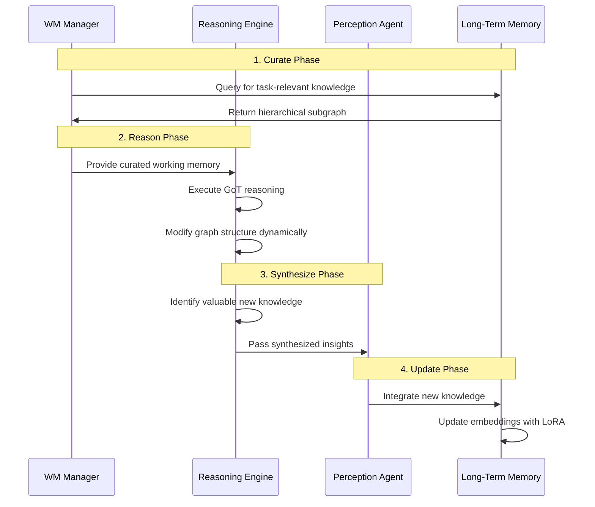
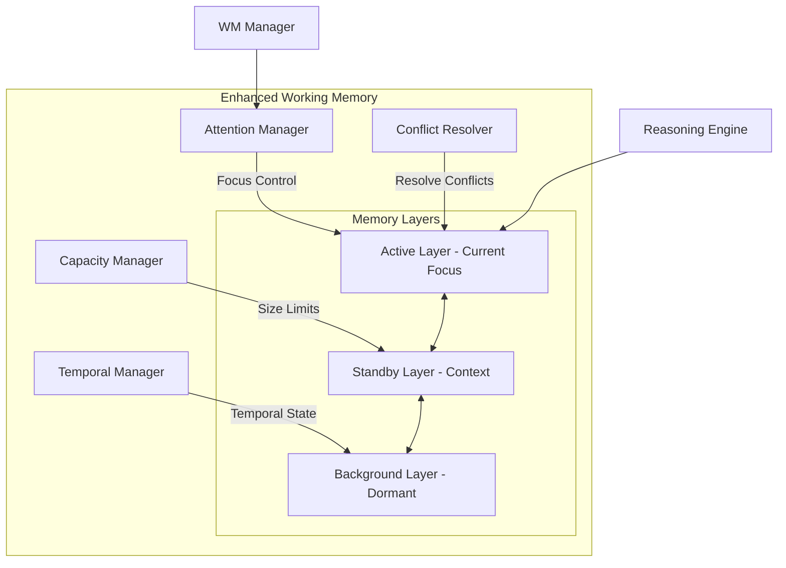
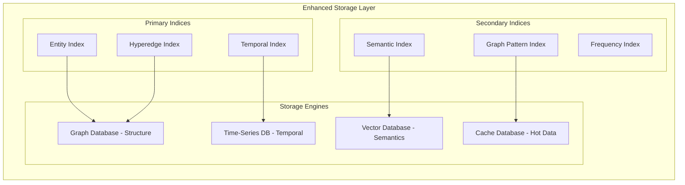
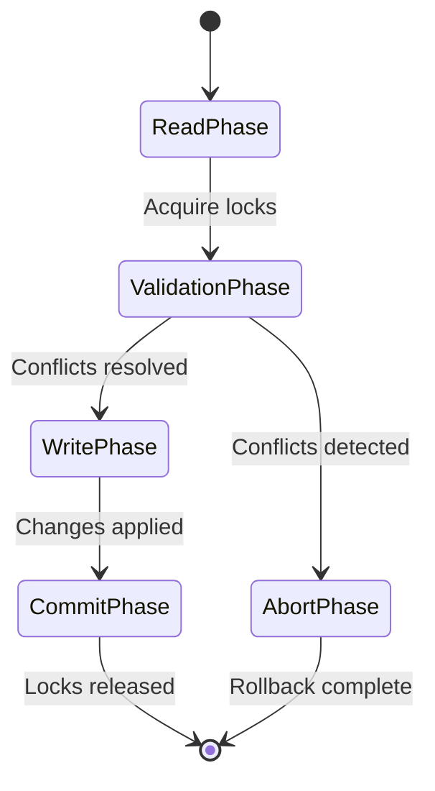
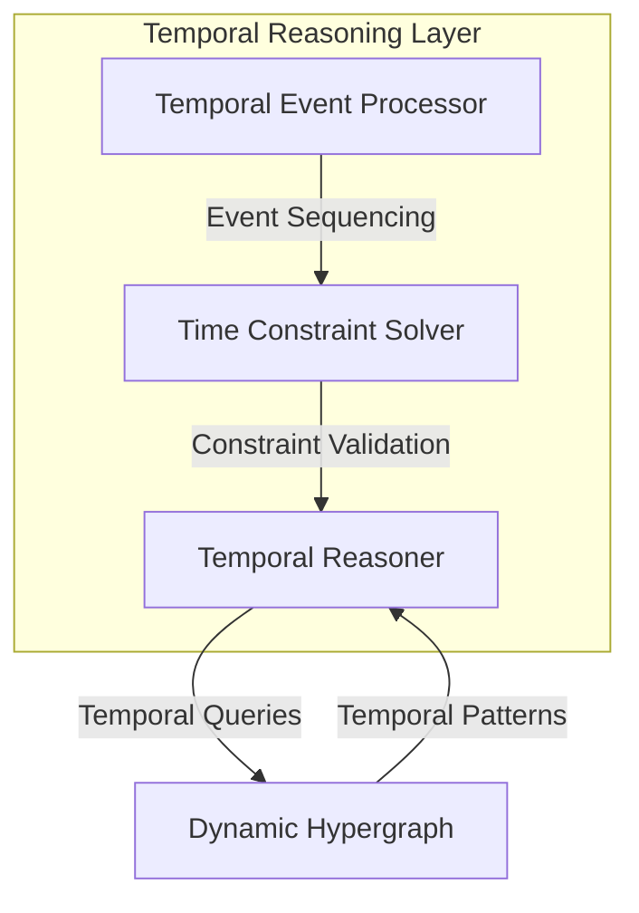
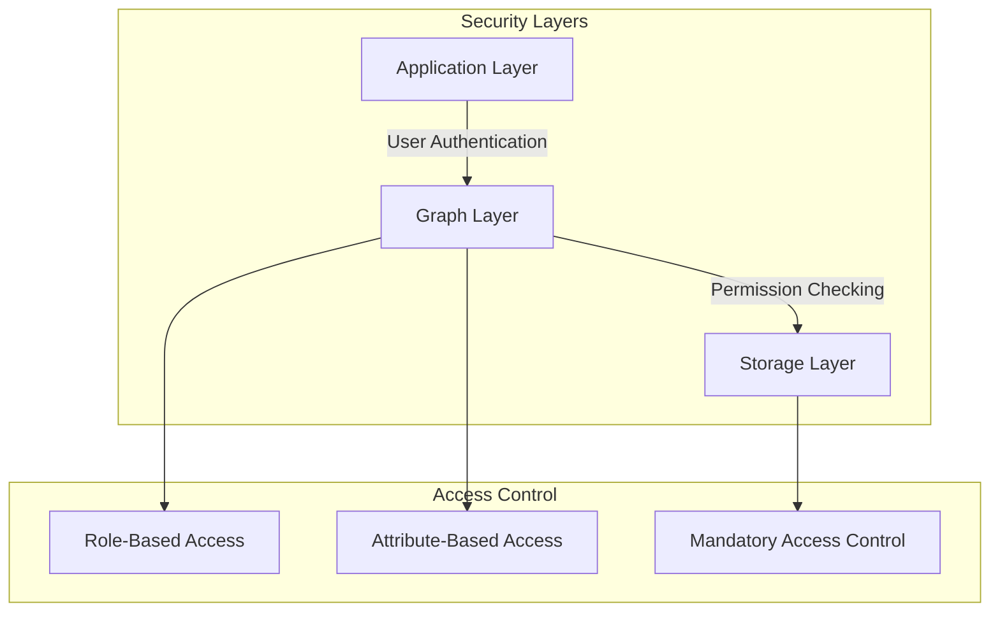

# H²-Cogent Architecture: Dynamic Hierarchical Hypergraph Framework for LLM Working and Long-Term Memory

## Overview

The H²-Cogent Architecture represents a paradigm shift in Large Language Model (LLM) cognitive frameworks, moving from linear reasoning chains to dynamic, hierarchical hypergraph structures. This architecture addresses fundamental limitations in current LLM memory systems by introducing a unified approach to both working and long-term memory through Dynamic Hierarchical Hypergraphs.

### Key Innovation Areas

- **Dynamic Hierarchical Hypergraphs**: Native support for n-ary relationships with multi-resolution knowledge representation
- **Active Memory Management**: Goal-driven context curation replacing passive retrieval mechanisms
- **Self-Modifying Reasoning**: Real-time graph structure updates during reasoning processes
- **Closed-Loop Learning**: Continuous knowledge integration from reasoning experiences

## Architecture

### System Overview

### Core Components

#### 1. Perception-Structuring Agent
**Primary Function**: Transform unstructured data into structured knowledge

**Key Capabilities**:
- LLM-driven n-ary relation extraction
- Ontology-guided Chain-of-Thought prompting
- Continuous incremental updates to Dynamic Knowledge Hypergraph
- Catastrophic forgetting prevention through continual learning

**Technical Implementation**:
- Employs advanced information extraction using ontology-guided CoT
- Integrates Continual Knowledge Graph Embedding (CKGE) techniques
- Utilizes adaptive Low-Rank Adaptation (LoRA) for parameter-efficient updates

#### 2. Active Working Memory Manager
**Primary Function**: Metacognitive controller for task-relevant memory curation

**Key Capabilities**:
- Goal-driven hypergraph construction from LTM
- Multi-resolution memory selection based on task complexity
- Hierarchical abstraction navigation
- Dynamic context window optimization

**Technical Implementation**:
- Implements Cognitive Workspace paradigm
- Uses sophisticated retrieval functions inspired by Generative Agents
- Performs active memory curation vs. passive semantic similarity search

#### 3. Dynamic Reasoning Engine
**Primary Function**: Execute graph-based reasoning with real-time structure modification

**Key Capabilities**:
- Graph of Thoughts (GoT) methodology implementation
- Dynamic node and hyperedge creation during reasoning
- Feedback loop integration for iterative refinement
- Multi-hop reasoning across hierarchical levels

**Technical Implementation**:
- Integrates Dynamic Graph Neural Network (DGNN) principles
- Supports arbitrary graph transformations during reasoning
- Enables thought aggregation and synthesis operations

### Memory Architecture

#### Dynamic Hierarchical Hypergraph Structure

#### Dynamic Knowledge Hypergraph (DKH) - Long-Term Memory

**Hybrid Storage Architecture**:

1. **Structured Core**: Native graph database (Neo4j) storing hypergraph skeleton
2. **Vector Augmentation**: Multi-modal vector indices for semantic search
   - Entity embeddings index
   - Hyperedge description embeddings
   - Raw text chunk embeddings

**Continual Learning Mechanism**:
- Parameter-efficient fine-tuning using adaptive LoRA
- Dedicated adapters for new knowledge components
- Catastrophic forgetting prevention through weight freezing

### Cognitive Flow Process

#### Memory-Reasoning Loop

## Technical Specifications

### Hypergraph Formalization

**Mathematical Definition**:
- Hypergraph H = (V, E) where:
  - V: Set of vertices (entities)
  - E: Set of hyperedges (n-ary relationships, n ≥ 2)
  
**Hierarchical Structure**:
- Level L₁: Fine-grained entities and relationships
- Level L₂: Community clusters via aggregation functions
- Level L₃: Abstract domain concepts

**Dynamic Operations**:
- Node addition: V' = V ∪ {v_new}
- Hyperedge creation: E' = E ∪ {e_new}
- Structure modification: Real-time graph updates during reasoning

### Continual Learning Implementation

**LoRA Integration**:
- Freeze pre-trained embedding model weights
- Inject trainable low-rank matrices for new knowledge
- Adapter allocation: A_new = {W_down, W_up} for each new component
- Update rule: h_new = h_frozen + A_new(x)

**Knowledge Integration Strategy**:
1. Identify new entities/relationships from reasoning
2. Allocate dedicated LoRA adapters
3. Train adapters on new knowledge without affecting existing embeddings
4. Update hypergraph structure incrementally

### Query Processing Architecture

**Multi-Modal Retrieval Pipeline**:

1. **Semantic Entry Point**: Vector search for relevant entities/hyperedges
2. **Structural Traversal**: Graph database exploration from entry points
3. **Hierarchical Navigation**: Multi-resolution knowledge extraction
4. **Context Assembly**: Coherent subgraph construction for reasoning

**Optimization Strategies**:
- Hierarchical pruning for large-scale graphs
- Adaptive abstraction level selection based on query complexity
- Dynamic context window management

## Component Interactions

### Agent Communication Protocol

| Source Agent | Target Agent | Message Type | Content |
|--------------|--------------|--------------|---------|
| WM Manager | DKH | Query | Task context + abstraction level |
| DKH | WM Manager | Response | Hierarchical subgraph |
| WM Manager | Reasoning Engine | Workspace | Curated working memory |
| Reasoning Engine | Reasoning Engine | Self-modification | Graph structure updates |
| Reasoning Engine | Perception Agent | Synthesis | Validated new knowledge |
| Perception Agent | DKH | Update | Structured knowledge integration |

### Data Flow Specifications

**Working Memory Construction**:
- Input: Task description + context
- Process: Goal-driven subgraph extraction from DKH
- Output: Multi-resolution hierarchical hypergraph

**Dynamic Reasoning Process**:
- Input: Working memory hypergraph
- Process: GoT execution with real-time modifications
- Output: Solution + enriched knowledge graph

**Knowledge Synthesis**:
- Input: Modified working memory graph
- Process: Validation + abstraction of new insights
- Output: Structured knowledge packets for LTM integration

## Testing Strategy

### Novel Benchmark: DyN-H (Dynamic N-ary Hierarchical Reasoning)

**Task Structure**:
1. **Initial State**: Incomplete knowledge hypergraph
2. **Update Stream**: Continuous unstructured information flow
3. **Complex Queries**: Multi-hop questions requiring hierarchical reasoning
4. **Conflict Resolution**: Knowledge contradiction handling

**Evaluation Metrics**:

| Metric | Description | Measurement |
|--------|-------------|-------------|
| Factual Consistency | Answer accuracy vs. ground truth | Precision/Recall |
| Reasoning Path Validity | Logic soundness of reasoning graph | LLM-as-judge scoring |
| Knowledge Integration Rate | Successful fact incorporation from updates | Percentage integrated |
| Hierarchical Navigation Efficiency | Effective use of abstraction levels | Comparison vs. flat baseline |

### Ablation Study Design

**Component Isolation Tests**:

1. **No Hierarchy**: Flat hypergraph vs. hierarchical structure
2. **No Dynamism**: Static working memory vs. dynamic modifications
3. **Passive RAG**: Standard retrieval vs. active memory curation
4. **No LTM Update**: Single-task vs. continual learning evaluation

**Baseline Comparisons**:
- GoT + RAG: Standard graph reasoning with vector retrieval
- HyperGraphRAG: Static hypergraph-based retrieval
- GraphCogent: Agentic graph reasoning without hierarchy

## Innovation Differentiators

### Unified Knowledge Representation
- Single hypergraph structure for all memory components
- Native n-ary relationship support
- Multi-resolution abstraction capability

### Active Memory Management
- Goal-driven context curation vs. passive retrieval
- Metacognitive workspace construction
- Task-adaptive abstraction level selection

### Self-Modifying Reasoning
- Real-time graph structure updates during reasoning
- Integration of reasoning products into knowledge base
- Closed-loop learning from reasoning experiences

### Theoretical Grounding
- Potential integration with Topos Theory for logical consistency
- Category theory foundations for hierarchical operations
- Formal guarantees for knowledge synthesis operations

## Implementation Analysis & Critical Improvements

### Current Implementation Gaps

**Working Memory Limitations Identified**:
1. **Memory Capacity Management**: No explicit mechanism for working memory size limits
2. **Attention Mechanisms**: Missing hypergraph-aware attention for focusing on relevant substructures
3. **Temporal Dynamics**: Lack of explicit temporal reasoning within working memory
4. **Conflict Resolution**: Insufficient handling of contradictory information in working memory
5. **Memory Persistence**: No specification for working memory state preservation across reasoning steps

**Storage Structure Deficiencies**:
1. **Indexing Strategy**: Inadequate multi-dimensional indexing for hypergraph queries
2. **Compression Mechanisms**: No data compression for large hypergraph structures
3. **Consistency Guarantees**: Missing ACID properties for concurrent hypergraph operations
4. **Version Control**: Lack of knowledge versioning and rollback capabilities

### Enhanced Working Memory Architecture

#### Attention-Aware Working Memory Manager

**Multi-Layer Working Memory Structure**:

| Layer | Capacity | Update Frequency | Content Type | Eviction Policy |
|-------|----------|------------------|--------------|------------------|
| Active | 50-100 nodes | Real-time | Current reasoning focus | LRU with importance weighting |
| Standby | 200-500 nodes | Per reasoning step | Supporting context | Semantic relevance scoring |
| Background | 1000+ nodes | Per task | Historical context | Temporal decay + access frequency |

#### Advanced Storage Architecture

**Multi-Index Hypergraph Storage**:

**Storage Optimization Strategies**:

1. **Hierarchical Caching**:
   - Hot cache: Frequently accessed hypergraph patterns
   - Warm cache: Recently used entity clusters
   - Cold storage: Archived knowledge with compression

2. **Adaptive Compression**:
   - Lossless compression for critical knowledge
   - Semantic compression for redundant patterns
   - Progressive compression based on access patterns

3. **Distributed Storage Architecture**:
   - Shard hypergraph by domain/topic
   - Replicate critical knowledge across nodes
   - Load balancing for query distribution

### Memory Coherence & Consistency

#### Transaction Management for Hypergraph Operations

**ACID Properties Implementation**:

**Consistency Mechanisms**:
- **Atomicity**: All-or-nothing hypergraph updates
- **Consistency**: Invariant preservation across hierarchy levels
- **Isolation**: Concurrent reasoning process separation
- **Durability**: Persistent storage with write-ahead logging

#### Knowledge Versioning System

**Temporal Knowledge Graph Structure**:

| Component | Versioning Strategy | Rollback Capability | Conflict Resolution |
|-----------|-------------------|---------------------|---------------------|
| Entities | Immutable with timestamps | Full history | Merge with confidence scores |
| Hyperedges | Copy-on-write | Selective rollback | Consensus-based resolution |
| Hierarchies | Snapshot-based | Level-wise rollback | Hierarchical reconciliation |

### Performance Optimization

#### Query Processing Enhancements

**Multi-Stage Query Execution**:

1. **Query Planning Phase**:
   - Hypergraph query optimization
   - Execution plan generation with cost estimation
   - Index selection strategy

2. **Parallel Execution Phase**:
   - Distributed graph traversal
   - Asynchronous hyperedge evaluation
   - Result streaming and aggregation

3. **Result Synthesis Phase**:
   - Hierarchical result merging
   - Confidence scoring and ranking
   - Context-aware result filtering

**Performance Metrics & Monitoring**:

| Metric Category | Specific Metrics | Target Performance |
|-----------------|------------------|--------------------|
| Query Latency | P95 response time | < 100ms for simple queries |
| Throughput | Queries per second | > 1000 QPS |
| Memory Efficiency | Working memory utilization | < 80% of allocated space |
| Cache Hit Rate | Index cache effectiveness | > 90% for frequent patterns |

### Advanced Reasoning Capabilities

#### Temporal Reasoning Integration

**Time-Aware Hypergraph Operations**:

**Temporal Operations**:
- **Before/After Reasoning**: Temporal precedence in hyperedges
- **Duration Constraints**: Time-bounded relationship validity
- **Causal Inference**: Cause-effect relationship discovery
- **Temporal Aggregation**: Time-series pattern recognition

#### Probabilistic Reasoning Support

**Uncertainty Management in Hypergraphs**:

| Uncertainty Type | Representation | Reasoning Method | Update Strategy |
|------------------|----------------|------------------|------------------|
| Entity Existence | Confidence scores [0,1] | Bayesian inference | Evidence accumulation |
| Relationship Validity | Probability distributions | Monte Carlo sampling | Belief propagation |
| Hierarchical Aggregation | Uncertainty intervals | Interval arithmetic | Conservative fusion |

### Scalability & Distribution

#### Horizontal Scaling Architecture

**Distributed Hypergraph Partitioning**:

1. **Domain-Based Partitioning**:
   - Partition by semantic domains
   - Minimize cross-partition edges
   - Load balancing across nodes

2. **Hierarchical Distribution**:
   - Abstract levels on coordinator nodes
   - Detailed levels on worker nodes
   - Adaptive rebalancing based on access patterns

3. **Replication Strategies**:
   - Critical knowledge multi-replica
   - Read replicas for query distribution
   - Eventual consistency with conflict resolution

### Security & Privacy Enhancements

#### Access Control for Hypergraphs

**Multi-Level Security Model**:

**Privacy-Preserving Mechanisms**:
- **Differential Privacy**: Noise injection for sensitive knowledge
- **Homomorphic Encryption**: Encrypted reasoning operations
- **Secure Multi-Party Computation**: Distributed reasoning without data sharing

### Implementation Roadmap

#### Phase 1: Core Infrastructure (Months 1-3)
- Enhanced working memory architecture
- Multi-index storage system
- Basic consistency mechanisms

#### Phase 2: Advanced Features (Months 4-6)
- Temporal reasoning capabilities
- Probabilistic reasoning support
- Performance optimization

#### Phase 3: Scale & Security (Months 7-9)
- Distributed architecture implementation
- Security and privacy features
- Production readiness

### Critical Success Metrics

| Phase | Key Performance Indicators | Success Criteria |
|-------|----------------------------|-------------------|
| Phase 1 | Memory efficiency, Query latency | 90% memory utilization, <50ms queries |
| Phase 2 | Reasoning accuracy, Temporal consistency | 95% accuracy, 99% temporal coherence |
| Phase 3 | Scalability, Security compliance | Linear scaling, SOC2 compliance |